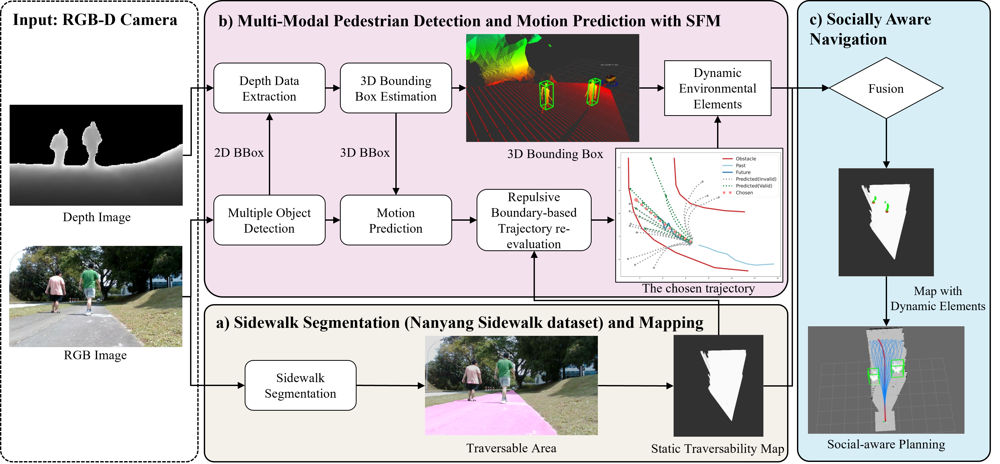

<div align="center">

# Socially Aware Last-Mile Delivery Robot

### Multi-modal perception, intention prediction, and socially aware planning for pedestrian-crowded sidewalks

[](https://doi.org/10.1109/CIS-RAM61939.2024.10672669)
[](https://drive.google.com/file/d/1Hgyy8d2Ny86SW00C9I1natI11ghpTu-X/view)
[](#system-overview)

**Official project repository for**<br>
[*Towards Safe and Efficient Last-Mile Delivery: A Multi-Modal Socially Aware Navigation Framework for Autonomous Robots on Pedestrian-Crowded Sidewalks*](https://ieeexplore.ieee.org/document/10672669)<br>
IEEE CIS/RAM 2024, pp. 392-398

Yichen Zhou\* · Mingxing Wen\* · Xun Chen · Chunyang Zhao · Jiajie Guo · Jun Zhang · Yufeng Yue · Yingchong Ma<br>
<sub>\* Equal contribution</sub>


[Overview](#overview) | [Framework](#system-overview) | [Dataset](#nanyang-sidewalk-dataset) | [Prediction](#pedestrian-intention-prediction) | [Planning](#socially-aware-motion-planning) | [Results](#experimental-highlights) | [Citation](#citation)

</div>

## Overview

Last-mile delivery robots operating on crowded sidewalks must solve three tightly coupled problems:

1. **Where can the robot travel?** Understand sidewalk semantics and construct a static traversability map.
2. **Where will pedestrians move?** Detect pedestrians in 3D and predict trajectories while respecting sidewalk boundaries.
3. **How should the robot behave?** Plan safe motion that follows local pedestrian etiquette.

This repository presents a complete multi-modal navigation framework that connects sidewalk segmentation, RGB-D pedestrian perception, social-force-guided trajectory prediction, and socially aware motion planning on a real Husky robot.

## System Overview

<p align="center">
  
</p>

| Module | Input | Core method | Output |
|:--|:--|:--|:--|
| **Sidewalk understanding** | RGB-D observations | Semantic segmentation trained on the Nanyang Sidewalk Dataset | Static traversability map |
| **Pedestrian perception and prediction** | RGB image, depth image, and pedestrian history | 2D detection and tracking, 3D bounding-box estimation, AgentFormer, and Social Force Model | Dynamic objects and boundary-aware trajectory predictions |
| **Socially aware navigation** | Static map, pedestrian states, and predicted trajectories | Two-stage state-lattice planning with collision checking and social-awareness cost | Safe, etiquette-aware robot trajectory |

The static and dynamic representations are fused into a local occupancy map. The planner then rejects unsafe candidates and selects a trajectory that follows pedestrian etiquette observed in Singapore: **keep left and overtake from the right**.

## Nanyang Sidewalk Dataset

<div align="center">

### [Download the Nanyang Sidewalk Dataset](https://drive.google.com/file/d/1Hgyy8d2Ny86SW00C9I1natI11ghpTu-X/view)


</div>

The dataset targets semantic segmentation in narrow, visually complex sidewalk environments - a domain that is not adequately represented by road-centric datasets such as Cityscapes and BDD100K.

| Property | Description |
|:--|:--|
| **Collection platform** | Husky robot with an Intel RealSense RGB-D camera |
| **Route** | Approximately 1 km along Nanyang Link, Singapore |
| **Source sequence** | 1,150-second video; one image sampled every 11 frames |
| **Dataset size** | 1,096 curated images; 2,076 images after targeted augmentation |
| **Image resolution** | 480 x 848 pixels |
| **Annotation format** | PASCAL VOC |
| **Semantic classes** | General obstacle, terrain, road, sidewalk, zebra crossing, pedestrian, and vehicle |
| **Split** | 75% training, 15% validation, and 15% testing |

<p align="center">
  
  <br>
  <em>Semantic segmentation results on representative sidewalk scenes.</em>
</p>

<p align="center">
  
  <br>
  <em>Comparison with models trained on road-centric datasets.</em>
</p>

## Pedestrian Intention Prediction

The perception stack combines RGB and depth information to recover pedestrian positions in 3D:

1. Detect and track pedestrians in the image.
2. Extract depth within each 2D bounding box and project it into 3D.
3. Remove the ground plane, cluster the remaining points, and estimate an oriented 3D bounding box.
4. Use AgentFormer to generate candidate future trajectories.
5. Re-evaluate the candidates with a Social Force Model boundary term, rejecting boundary-crossing paths and favoring socially plausible motion.

### PedSim evaluation scenarios

<p align="center">
  
</p>

### Repulsive-boundary-based trajectory selection

<p align="center">
  
</p>

The boundary-aware re-ranking step improves prediction across straight, circular, and turning sidewalks, with the largest reported ADE improvement appearing in the turning scenario.

## Socially Aware Motion Planning

The planner first removes trajectories that collide with non-traversable areas, current pedestrian positions, or predicted pedestrian motion. It then ranks the remaining candidates using target progress, trajectory continuity, obstacle clearance, and an adaptive social-awareness cost.

<table>
  <tr>
    <td width="50%" align="center">
      <b>Overtake from the right</b><br><br>
      
    </td>
    <td width="50%" align="center">
      <b>Keep to the left</b><br><br>
      
    </td>
  </tr>
</table>

## Experimental Highlights

- **Sidewalk-specific perception:** Mask2Former trained on the Nanyang Sidewalk Dataset achieved **95.3% mIoU** on the project test set, compared with 39.3% and 33.8% when trained on BDD100K and Cityscapes, respectively.
- **Real-time deployment:** TensorRT SegFormer ran at **10-15 FPS** using approximately **3.02 GB GPU memory** on the robot platform while achieving **93.7% mIoU**.
- **Boundary-aware prediction:** AgentFormer with the repulsive-boundary process produced the best ADE/FDE results across all three PedSim scenarios evaluated in the paper.
- **Real-world social navigation:** The complete framework was demonstrated on a differential-drive Husky robot with an RGB-D camera in overtaking and keep-left scenarios.

### Trajectory prediction ablation

| Scenario | Metric | AgentFormer + RB | AgentFormer | CTRV-EKF |
|:--|:--:|--:|--:|--:|
| Straight sidewalk | ADE / FDE (m) | **0.587 / 1.194** | 0.589 / 1.197 | 1.743 / 1.631 |
| Circular sidewalk | ADE / FDE (m) | **0.837 / 1.607** | 0.867 / 1.669 | 2.197 / 2.035 |
| Turning sidewalk | ADE / FDE (m) | **0.842 / 1.692** | 0.892 / 1.702 | 1.977 / 1.831 |

RB denotes the repulsive-boundary-based trajectory selection process.

## Citation

If this project or the Nanyang Sidewalk Dataset is useful in your research, please cite:

```bibtex
@inproceedings{zhou2024towards,
  title     = {Towards Safe and Efficient Last-Mile Delivery: A Multi-Modal Socially Aware Navigation Framework for Autonomous Robots on Pedestrian-Crowded Sidewalks},
  author    = {Zhou, Yichen and Wen, Mingxing and Chen, Xun and Zhao, Chunyang and Guo, Jiajie and Zhang, Jun and Yue, Yufeng and Ma, Yingchong},
  booktitle = {2024 IEEE International Conference on Cybernetics and Intelligent Systems (CIS) and IEEE International Conference on Robotics, Automation and Mechatronics (RAM)},
  pages     = {392--398},
  year      = {2024},
  doi       = {10.1109/CIS-RAM61939.2024.10672669},
  organization = {IEEE}
}
```

## Acknowledgements

We thank the developers of [Pedsim](https://github.com/srl-freiburg/pedsim_ros), [MMSegmentation](https://github.com/open-mmlab/mmsegmentation), [AgentFormer](https://ye-yuan.com/agentformer/), and the broader open-source robotics community whose work supported this project.

---

<div align="center">
  <sub>Safe navigation is more than collision avoidance - it is motion that people can understand and trust.</sub>
</div>
